  <picture>
    <source media="(prefers-color-scheme: dark)" srcset="assets/signature-dark.svg">
    
  </picture>

Building things that hold up under real load, mostly around language models, inference, and software I wish existed.

Published [MzansiLM](https://github.com/Anri-Lombard/sallm) (LREC 2026) and [Mamba-SAFE](https://github.com/Anri-Lombard/Mamba-SAFE) (NeurIPS 2024 workshop).

[Website](https://anri-lombard.vercel.app) · [LinkedIn](https://www.linkedin.com/in/anri-m-lombard/) · [X](https://x.com/lombard_anri) · [Email](mailto:anri.m.lombard@gmail.com)
